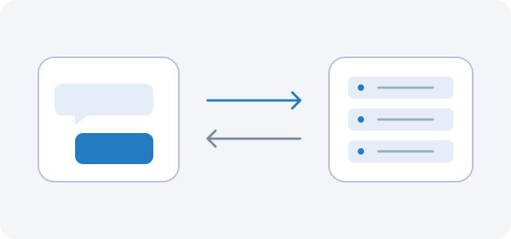

# dsh_antigen — the AntiGem bridge for DeepSeek Harness

Exposes the seven MCP servers that the AntiGem Android app runs on its loopback bridge to DeepSeek Harness, so a session can control the app and the phone directly instead of being limited to files and shell.

| Tool prefix | Bridge path | What it gives the session |
| --- | --- | --- |
| `mcp__browser__*` | `/browser` | Read and drive the app's webview tabs. |
| `mcp__terminal__*` | `/terminal` | The app's terminal sessions, alongside the guest shell. |
| `mcp__google_flow__*` | `/google_flow` | Google Flow automation. |
| `mcp__custom_plugin_developer__*` | `/extension_developer` | The webview-extension developer MCP: draft, write, install and test app extensions. |
| `mcp__android_automation__*` | `/android` | Device control through the app's automation service. |
| `mcp__notes__*` | `/notes` | The app's notes store. |
| `mcp__theme__*` | `/theme` | The app's theming. |

## Sandbox and approvals

The bundle sets one sandbox mode and leaves approvals alone:

| `ANTIGEM_FULL_ACCESS` | Mode |
| --- | --- |
| `1` | `danger-full-access` |
| anything else | `DSH_PERMISSION_MODE`, or `workspace-write` when unset |

The app sends the variable on every boot, `0` included. `workspaceRoot` is `process.cwd()`. The `danger-full-access-ask` preset is defined because `permission-presets` refuses to boot when a sandbox and approval pair matches no preset; it is never selected by this bundle.

## Sessions

Every chat the app starts runs in one shared guest directory. The harness files sessions by working directory, so putting both sides in the same one is what makes a session started in the app appear in the harness's own web page and the other way round. Sessions saved under a different directory keep it and resume there.
